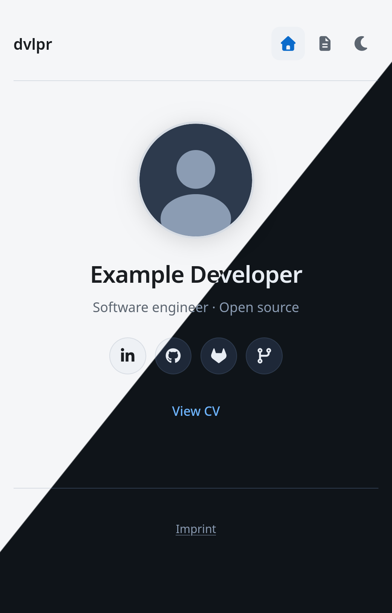
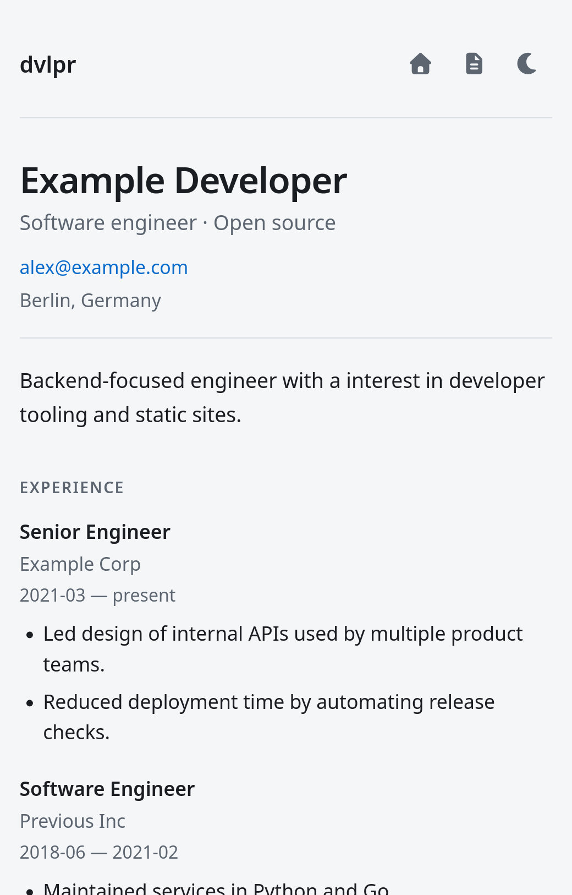

# staticvita 🪪

A lightweight yet customizable static site generator built on [staticjinja](https://github.com/staticjinja/staticjinja), designed to generate a link tree and CV from JSON data. The focus is on a minimal footprint and producing output that is accessible to both machines (such as search engines and CV parsers) and assistive technologies like screen readers.

**Demo:** [bnthn.github.io/staticvita](https://bnthn.github.io/staticvita)

<p> 

## Requirements

- Python 3.9+

## Install

```bash
pip install staticvita
```


## Build a site

Copy [site.example.json](site.example.json) to `site.json` and run `staticvita`.

Field reference: [SITE.md](SITE.md).

```bash
staticvita                      # site.json → dist/
staticvita -i site.json         # ./site.json, else data/site.json
staticvita -C /path/to/project  # build that directory
```

Open `dist/index.html` in a browser, or serve the `dist/` directory with any static file server.

### This repository

From a clone, at the repository root:

```bash
./build.sh
```

That creates a local virtual environment at `venv/` if needed, installs the package, copies `site.example.json` to `site.json` when that file is missing, and runs `staticvita`.

## Contributing

Development notes are in [CONTRIBUTING.md](CONTRIBUTING.md).